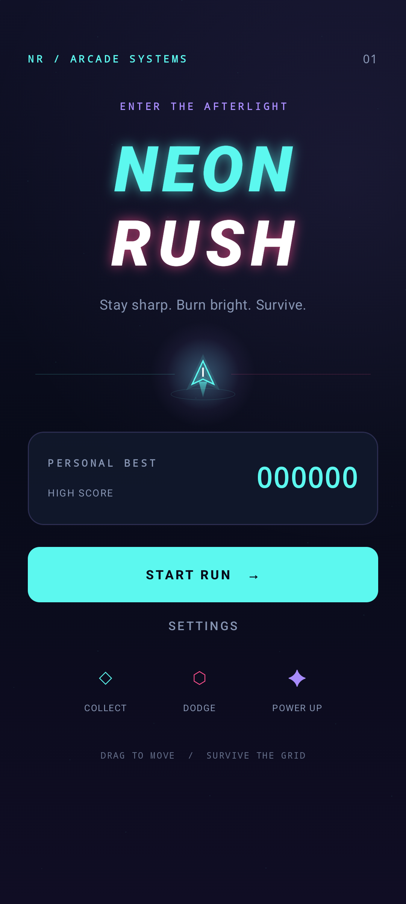
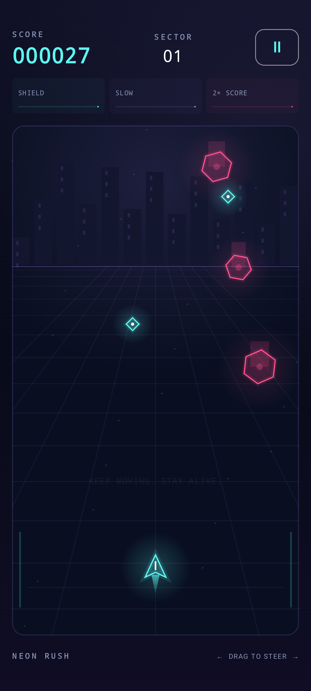
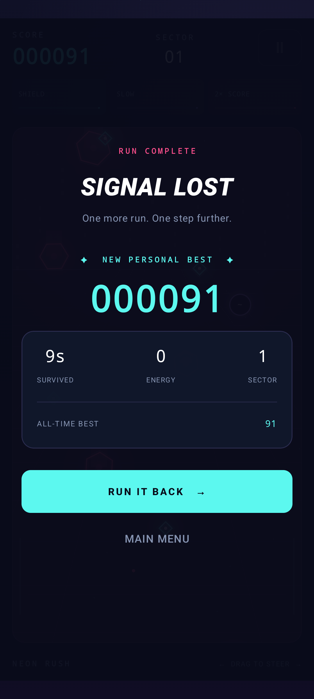

<div align="center">

# NEON RUSH

**Stay sharp. Burn bright. Survive.**

A neon cyberpunk survival arcade game for Android — built with Kotlin and Jetpack Compose Canvas.

**Android 8.0+ · Material 3 · MVVM · Original synthwave audio**

[Gameplay](#gameplay) · [Screenshots](#screenshots) · [Architecture](#architecture) · [Build](#build--install) · [Audio](#original-audio)

</div>

## Overview

Steer a glowing ship through a futuristic grid, dodge falling hazards, and gather energy while the city gets faster. Neon Rush combines a compact arcade loop with procedural neon visuals, particles, a synthwave soundtrack, and persistent personal bests.

The project deliberately stays within one Android app module. The simulation is pure Kotlin, rendering uses Compose Canvas, and platform audio remains separate from game rules.

## Screenshots

These images are captured from the running Android app on an API 36 emulator. They show real rendered screens and a naturally completed run, with no mocked game state or generated artwork.

| Main menu | Gameplay | Game over |
| :---: | :---: | :---: |
|  |  |  |

See [capture details](docs/screenshots/README.md) for the device and reproduction steps.

## Features

- Smooth horizontal touch steering with density-independent game coordinates.
- Falling hazards, energy pickups, survival scoring, and increasing difficulty.
- Swept-circle collision detection to catch fast movement between frames.
- Shield, slow-motion, and score-multiplier power-ups with visible countdowns.
- Main menu, gameplay, pause, game over, and settings screens.
- Procedural city silhouettes, perspective grid, neon glow, particles, and an animated menu ship.
- Original looping synthwave music and six short sound effects.
- Independent Music/SFX volume sliders, particle and haptic toggles.
- DataStore-backed high scores and settings, with automatic saving.
- Lifecycle-aware gameplay and audio, audio-focus handling, and headphone-disconnect protection.
- Unit tests plus emulator tests for navigation, lifecycle, settings, audio decoding, and screenshots.

## Gameplay

Drag horizontally anywhere inside the arena to steer. Avoid pink hexagonal hazards and collect cyan diamonds. Survive as long as possible; one unshielded hit ends the run.

| Action or pickup | Effect |
| --- | --- |
| Survive | Earn 10 points per second |
| Collect energy | Earn 50 points |
| **S — Shield** | Absorb one hit; expires after 12 seconds |
| **~ — Slow motion** | Slow the falling field for 6 seconds while keeping player movement responsive |
| **2× — Multiplier** | Double survival and energy points for 8 seconds |
| Pause button / Android Back | Pause the current run |

Power-ups activate on collection. Different types stack; collecting the same type refreshes its duration. Hazard speed and spawn frequency increase over time with bounded maximums. Near misses trigger a short whoosh without changing the score.

Leaving the app pauses a run. Returning shows the pause screen until you choose **Resume Run**. Activity recreation retains the run through its ViewModel; process death starts a fresh session. Returning to the menu from pause saves the current score.

## Tech stack

| Concern | Implementation |
| --- | --- |
| Language | Kotlin |
| UI | Jetpack Compose, Material 3, Canvas |
| State | ViewModel, StateFlow, one-shot SharedFlow sound cues |
| Dependency injection | Hilt with kapt |
| Persistence | Preferences DataStore |
| Audio | Android MediaPlayer for music, SoundPool for effects |
| Testing | JUnit 4, AndroidX Test, Compose UI testing |
| Build | Gradle wrapper, Android Gradle Plugin 8.9.1, Kotlin 2.0.21 |

No game engine, networking SDK, navigation framework, or third-party audio runtime is required.

## Architecture

```text
com.jrustam.neonrush/
├── MainActivity.kt          Activity lifecycle and audio ownership
├── NeonRushApplication.kt   Hilt application
├── game/
│   └── GameEngine.kt        Pure Kotlin simulation, entities, collision, scoring, events
├── data/
│   └── GameRepository.kt    Atomic high-score updates and saved settings
├── audio/
│   ├── GameAudio.kt         MediaPlayer, SoundPool, focus, cleanup
│   └── AudioPolicy.kt      Platform-independent playback/volume rules
└── ui/
    ├── GameViewModel.kt     StateFlow snapshots, screen state, sound cues
    ├── NeonRushApp.kt       Screens, HUD, settings
    ├── GameCanvas.kt        Touch input and procedural rendering
    └── theme/              Colors and typography
```

The engine simulates a logical **360 × 640** world using bounded substeps, exponential movement smoothing, and relative swept collisions. Compose's frame clock advances the simulation while a run is active. Canvas reads frame state during drawing, avoiding screen-wide recomposition on every frame; the HUD updates at approximately 10 Hz. Particle count, hazard speed, spawn rate, and long frame deltas are bounded.

The engine emits semantic events once per interaction. The ViewModel translates them to non-replaying sound cues; the Activity collects cues only while resumed. Hilt gives each Activity its own audio controller, which holds only the application context and releases all native resources when destroyed.

DataStore preserves the maximum recorded score and clamps saved volume values. Audio waits for saved preferences before starting, so a muted session stays muted during cold launch.

## Original audio

**Afterlight Circuit** is a 38.4-second, 100 BPM synthwave loop composed procedurally for this project. Additive synths, arpeggios, bass, and synthesized drums create the soundtrack. All effects are also synthesized from original oscillator/noise functions:

- Glass-like crash fragments.
- Electric energy pickup.
- Near-miss whoosh.
- Ascending power-up activation.
- Descending Game Over motif.
- Short UI click.

The audio files and generator are **CC0-1.0**, with no third-party samples. See [asset provenance and permissions](docs/audio/README.md).

Music plays in the menu, settings, and active gameplay; it pauses during pause and game-over screens. Backgrounding stops effects and pauses music. Audio-focus loss pauses a run, ducking reduces audio level, and disconnecting headphones silences playback until interaction or foreground return. Resume continues the music position within the same Activity; recreating the Activity restarts its player. A delayed Game Over cue is cancelled if the user immediately retries or leaves the app.

Music and SFX sliders save on release. Zero mutes the respective channel. Android's media volume remains the master level. Assets are bundled; no network or storage permission is required.

To regenerate assets, use Python 3 with NumPy and FFmpeg:

```sh
python3 tools/generate_audio.py
```

These tools are for asset authoring only; normal app builds use the included files.

## Build & install

### Requirements

- Android Studio with JDK 17 or newer (the bundled JDK works).
- Android SDK Platform 36 and its build tools.
- An emulator or Android device running API 26 or newer.

Open the project root in Android Studio, let Gradle sync, select the **app** configuration and a device, then press **Run**. Keep the existing package name: `com.jrustam.neonrush`.

From a terminal at the project root:

```sh
./gradlew :app:assembleDebug
adb install -r app/build/outputs/apk/debug/app-debug.apk
```

The debug APK is intended for local testing. Release signing credentials are not included. Use `gradlew.bat` on Windows. If the compiler daemon is unavailable in a restricted environment, append `-Pkotlin.compiler.execution.strategy=in-process`.

### Tests and checks

```sh
# Local scoring, collision, audio-policy and event tests; Android lint
./gradlew :app:testDebugUnitTest :app:lintDebug

# With an unlocked emulator/device connected
./gradlew :app:connectedDebugAndroidTest
```

`GameSmokeTest` drives real UI navigation, captures three screens, verifies pause/resume and backgrounding, recreates the Activity, checks persisted volume settings, and asks Android to decode every audio asset. The test temporarily adjusts audio settings and restores them afterward. Its natural game-over run can update the device's high score; use a test emulator.

For device listening checks, collect energy and each power-up, pass close to a hazard, crash, and retry. Check the loop boundary, both volume sliders, focus loss to another media app, headphone disconnection, background/foreground, and rotation. Decoder and policy tests complement listening; they do not measure perceived sound quality or output latency.

## Scope

Neon Rush is a local arcade portfolio project. Accounts, ads, online leaderboards, multiplayer, and monetization are outside its scope. Build output, IDE state, local SDK paths, and signing material are excluded from version control; audio and documentation screenshots belong in source control.
